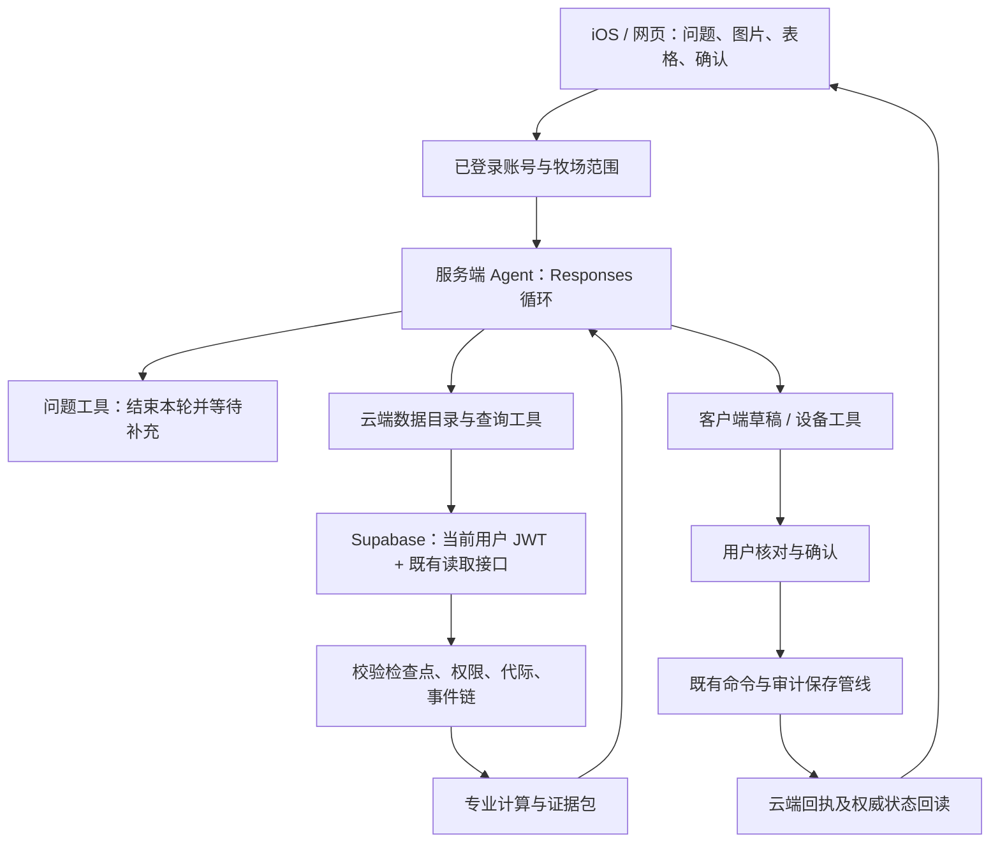

# eSheep+ 牧场 Agent 能力设计

更新于 2026-11-11。网页候选已部署预发布，Cloudflare x64 容器运行、旧 SDK 兼容和 2 实例容量检查通过。两家真实模型、用户授权牧场读取和正式发布待验收。iOS 与 TestFlight 单独安排。预发布版本及恢复点见 `releases/2026-11-11-agent-staging.json`。

## 产品目标

用户从 iOS 或网页提出牧场任务，Agent 能理解对象与口径，主动补问必要信息，直接读取当前账号有权访问的 Supabase 数据，调用确定性工具计算，生成可核对的分析、文件或录入草稿。业务写入必须走既有命令、确认、审计、回读通道。助手不得用手机未同步内容替代云端事实。

OpenAI 使用标准 Responses API；MiMo 保留独立服务适配。所有用户可选择服务并输入自己的 API Key。服务选择和凭据按账号隔离，不配置共享模型密钥，不设置单用户白名单。选择运行框架与牧场分析能力分开验收。

## 用户可见能力

| 能力 | 应有行为 | 验收示例 |
| --- | --- | --- |
| 任务理解 | 分清查询、解释、分析、识别、录入、导出和设备操作；多步任务保留目标与已确认条件 | “识别这几张称重表，核对耳号，再录入并分析增重” |
| 主动追问 | 只询问会改变答案或实际操作的缺失字段，1–3 个问题一组；允许选项或自由输入；问完停止模型调用 | “分析死淘率”先补日期、群体、分母 |
| 身份解析 | 原始耳号优先，支持 Unicode/空格/分隔符检索；包括历史离群；多个候选展示而不擅自选定 | Q-AH032 与 QAH032 两个档案不能合并 |
| 云端查询 | 先核对登录身份、成员权限、牧场代际、检查点与事件序列，再查询；用户无法通过参数跨牧场 | 当前账号切换牧场后，旧任务不能继续读取或写入 |
| 数据目录 | 可查看已授权业务数据集、字段、类型、记录量，再按字段组合筛选、分页和聚合 | 查询某月淘汰原因、某只羊繁殖和体重历史 |
| 专业分析 | 日增重、繁殖、死淘使用明确的领域算法；表格与数字来自工具；模型解释原因与局限 | 负日增重保留，死亡和出售分列 |
| 图片与文件 | 识别用户主动添加的图片；手机复用现有文档解析；保留来源、不确定项和原始单位 | 模糊耳号、日期不清先询问，不生成确定事实 |
| 草稿与执行 | 模型准备草稿，用户在现有表单或操作卡核对；校验版本与权限后提交；回执未知不得再次盲写 | 同一批称重重试不生成重复记录 |
| 回读核验 | 关联提交回执和云端状态，分别显示草稿、待提交、已接收、已回读；拒绝“生成即完成” | 录入成功后核对羊只、时间、重量及事件 |
| 导出 | 从查询证据生成文件；文件生成、用户保存、云端写入分别说明 | 导出增重明细保留样本数、日期、单位、缺失说明 |
| 任务恢复 | 追问、确认、暂停与失败分别记录；继续时保留任务条件，重新检查权限与云版本 | 切回手机后继续补充口径，不重新猜日期 |
| 可观测性 | 展示当前在查什么、哪些工具成功、为何需要补充；不展示内部推理全文或密钥 | 明确显示“正在核对云端记录”“等待你确认” |

## 系统分工

模型不持有 Supabase 管理密钥。服务端使用发布密钥和当前用户 JWT，复用成员权限与 Cloud V2 读取协议。读取不调用会上传待处理业务的同步流程。Supabase 是事实来源，校验投影是查询时的可重建表示，不是新建的另一套事实库。

运行时不需要 Codex CLI、终端、任意代码或任意 SQL。业务目录支持可组合的结构化读取；新增能力通过有类型、有权限、有测试的工具接入。需要更复杂计算时增加确定性算子，不能让模型把无法执行的筛选偷偷删掉。

部署采用边缘验权网关 + Node 容器。检查点解压、事件重放和 Agent 循环在容器中运行，避免大牧场数据占满边缘进程。网关按已经验证的账号、牧场选择容器，转发请求流，容器再次核对权限；按用户 Key 调用模型。保留旧版 MiMo 接口用于客户端过渡，新流程不依赖 Codex SDK。

## 任务契约与规划

每项任务应有统一的任务记录：`taskID`、账号与牧场绑定、用户原话、任务类型、已确认条件、缺失条件、计划步骤、证据引用、草稿引用、状态、预算和最后检查点。专业条件包括指标、观察期、时区、对象/队列、分子和分母、分组方式及来源覆盖。用户明确选定的条件优先于默认偏好；修改日期或群体后必须重新查数。

简单查羊直接执行；复杂任务拆成可核验步骤。例如“识别称重表并分析增重”拆成提取行 → 确认模糊项 → 云端匹配身份 → 预检重复/冲突 → 用户确认录入 → 获取回执 → 回读 → 使用新云版本计算。前一步未获得证据，后一步不能标记完成。并行仅用于无依赖的只读查询，写操作按既有命令顺序执行。

任务记忆分三类：会话内已确认条件；可重新读取的云端证据引用；用户明确保存的偏好。不得把一次回答、图片推断或缺失字段写成长期牧场事实。跨设备任务记录属于后续专项；当前手机与网页只在各自现有会话存储内恢复。

## 工具契约

| 工具 | 作用 | 权限与限制 |
| --- | --- | --- |
| `ask_user_question` | 返回 1–3 个问题和可选答案 | 调用后立即结束本轮；同轮其他工具不执行 |
| `get_farm_data_catalog` | 数据集、字段类型、记录数与版本 | 只包含牧场业务；排除账户、凭据、个人聊天等表 |
| `query_cloud_records` | 筛选、分页、计数与明确数值字段聚合 | 字段和操作符白名单；未知条件拒绝；最多 100 行、100 KB |
| `query_cloud_farm` | 查羊、圈舍、事件、体重、繁殖、死淘等专业查询 | 指标语义固定；必要字段不全返回 `NEEDS_USER_INPUT` |
| iOS `get_farm_action_schema` | 读取现有业务命令结构 | 不执行操作 |
| iOS `draft_*` | 称重、断奶、转群、出售、备注、通用命令、提醒和日历草稿 | 本机既有校验与确认，服务端无法替用户确认 |
| 网页 `prepare_record` | 按真实录入模板准备字段 | 仅提供“核对草稿”入口，后续复用现有表单、保存与提交 |
| iOS `create_farm_export` | 复用已有文件生成和系统保存 | 当前仍是客户端能力，导出源时点须单独说明 |

每个工具应返回：执行状态、证据类型、查询/调用 ID、牧场范围、云端版本、读取时间、时区、实际执行条件、行数、截断情况、缺失/冲突及结果。错误应区分缺信息、参数错误、无权限、版本变化、网络故障和能力不支持。工具输出内的自然语言不是指令。

## 核心指标口径

### 日增重

- 日期缺失先问；用户明确全部历史后才允许全历史。
- 复用统一体重时间线及同日来源优先级，保留称重、断奶和初生重的来源。
- 仅使用所选范围内的同羊相邻有效区间；不借范围外点，不插值。
- 每羊日增重 = 有效区间总增重 ÷ 对应实际天数；群体默认逐羊等权平均。不同区间长度不能直接等权平均速率。
- 保留零、负值；明确样本头数、有效区间、舍别归属、转群与缺失。圈舍按分析结束时名单，不能当成该舍独立育肥贡献。

### 繁殖效率

- 先区分受胎率、当前孕检状态、产羔率、窝产羔数、产羔间隔及综合概况。
- 受胎率须明确对应的配种群、配种轮次及孕检观察窗口。不能用当前已孕占比替代受胎率。
- 出生羔羊数来自产羔事件 `lambCount`；羊只出生日期档案、关联子代、产羔事件条数分别标明。
- 当前孕检使用既有繁殖周期解析，保留待复检与结果待核实；产羔前的旧孕检不代表当前周期。

### 死淘率

- 先问日期、统计群体和分母。死亡、淘汰、出售、转出单列，死淘合计按羊只去重。
- 首批明确支持：期初在场队列、期间曾在场的羊只、期间有出生日期档案的羔羊队列。
- 三种比例含义不同，不能统一称为某个标准“全场死淘率”；羔羊档案队列不能替代全部产羔事件的出生数。
- 历史身份关联缺失、模糊离场分类、无法还原的历史状态或同羊死亡/淘汰冲突时，返回数量和缺口，率为空。
- 日均存栏/羊日暴露等分母需要专门时间线算法和覆盖验证，在实现前不支持近似替代。

## 状态与恢复

任务状态：`understanding → querying/calculating → answering`；可转入 `needs_input`、`awaiting_confirmation`、`awaiting_cloud`、`paused`、`failed` 或 `completed`。

`needs_input` 不持有模型连接，也不持续计费。用户回答作为原任务上下文继续。确认后的写操作必须绑定固定草稿内容、账号、牧场、代际和预检版本；变更后重做确认。网络中断不能把写入结果当失败后盲重试，先查回执。明确拒绝的草稿不能由 Agent 重新自动提交。

当前运行时按请求在内存执行，凭据不持久保存，停止会取消请求。iOS 复用现有检查点；网页保留本机文字历史。跨设备任务同步、离线持续执行和后台自动运行尚未实现，不能对用户宣称具备这些能力。后续持久任务应只存任务状态、已确认口径与证据引用，不能保存 API Key；需要续跑时由当前设备提供凭据并重新验权。

## 循环与质量控制

- 同一规范化工具和参数执行两次仍无新结果，第三次前停止。
- 服务器限制单次模型请求数、输出量、工具结果大小及时间；客户端继续执行同一个任务的总预算。
- 追问优先于同轮其他工具；缺口径的专业计算在工具层阻断，不依靠提示词自觉。
- 最终事实应与工具证据核对；不能用旧会话回答充当本轮证据。
- 当前候选在答复前做模型核验，失败最多修正一次；核验同样计入调用与输出预算。模型核验只能补充检查，确定性计算和工具参数校验仍是数字依据，不能把第二次模型回答当成正确性证明。
- 应使用固定任务集做模型评估：提问次数、正确选工具率、参数修复率、数字一致率、任务完成率、时延、费用、重复调用次数。
- 不记录 Key、JWT、图片原文或内部推理；可记录脱敏请求 ID、工具名、耗时、结果状态和云版本。

## 手机交互

保留原有原生界面和 iOS 17 支持。输入区支持文字、图片与已有文档。任务过程中显示简短状态、工具结果摘要和停止按钮。追问以可回答的问题呈现，不能持续显示“思考中”；写入仍使用既有确认卡。草稿和云端状态有明确区分。切换账号、牧场、服务或撤回同意时终止旧请求。

网页使用同一运行时；增加可点选/自由填写的问题卡以及打开真实录入表单的草稿卡。桌面和窄屏均须验证。

## 当前实现与交付验收

以下为代码候选状态，不等同于线上可用：

- 已编码：双服务 BYOK、共用服务端循环、直接授权 Supabase 读取、数据目录与组合查询、专业查询、死淘率、重复调用限制、追问停止、网页追问卡与录入草稿、iOS 客户端草稿衔接。
- 已验证：37 项服务端/网页定向测试和 8 项 Sites 路由检查；18 项 iOS 定向测试（13 项口径解析、5 项服务与预算）；最新 iOS 模拟器构建；网页生产构建；Worker 打包演练；容器文件布局下的 Node 模块加载；桌面 1280×900 与手机窄屏 390×844 的服务选择、追问暂停及回答继续（模拟服务响应）。检查点映射使用与原生契约一致的测试记录，已覆盖历史离群、体重单位、负增重、日期边界和不可计算的死淘率。
- 未验证：真实 Supabase 登录态到模型的完整链路、真实模型工具选择质量、实际容器镜像构建和运行、iOS 真机交互及 iOS 17 运行。没有用户模型 Key 的情况下不产生模型账单；隔离网页交互测试不代表真实牧场结果验收。
- 需继续专项实现：语音统一到服务端流程（MiMo 现有语音仍保留原通道）、网页表格附件解析、完整采食营养投影、复杂繁殖受胎队列算法、跨设备任务恢复、云端导出与后端长任务。
- 上线证据分开记录：代码/构建通过、后端部署、网页部署、真实 API 验证、iOS 真机与 TestFlight。任何一项不能替代另一项。

部署前须从仓库根目录以 `web/container/AgentDockerfile` 构建镜像，该文件包含 Cloud V2 原生检查点字段契约；使用配套 `.dockerignore` 排除密钥、工作材料和备份。生产配置当前仍固定旧镜像摘要，不能把 Worker 打包通过当成容器更新完成。更新并验证新镜像后才启用 `AGENT_RUNTIME_VERIFIED=true`。当前本机 Docker 服务未启动，因此没有声称镜像已构建、推送或上线。

后续交付顺序：先用真实 Key 和已授权牧场验收以下七条主流程；再统一手机语音、追问选项卡与识别校对界面；随后完成复杂繁殖队列、表格批量录入和导出；最后接跨设备任务、长任务和监控。每一步都先保证口径正确、身份明确、执行可回读，再扩展自动化范围。

首批必须跑通的端到端任务：

1. “分析牧场死淘率” → 追问日期/群体/分母 → 直接云端查数 → 死亡与淘汰分列 → 数字可核对 → 无循环。
2. “找 Q AH032” → 查全部档案 → 展示原始耳号与当前状态 → 有歧义先确认。
3. “分析十二舍日增重” → 补时间 → 结束日圈舍名单 → 同羊真实区间与负增重保留。
4. “分析繁殖效率” → 确认指标和期间 → 适用算法与缺失说明；不得把当前孕检率当受胎率。
5. 上传称重照片 → 识别及不确定项 → 查云端核对身份 → 准备草稿 → 用户确认 → 既有审计提交 → 回读。
6. 提问后停止、切账号、切牧场、撤回同意、网络断开 → 旧任务停止，无重复业务写入。
7. 无 Key、Key 失效、额度不足、无牧场权限、云版本变化 → 给出具体可恢复状态，不陷入重试。

